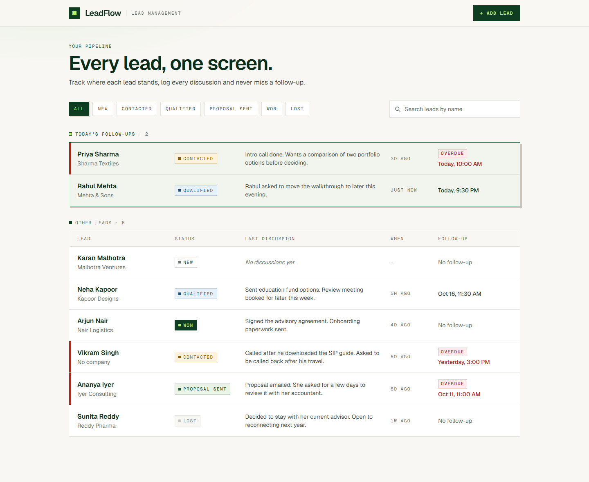
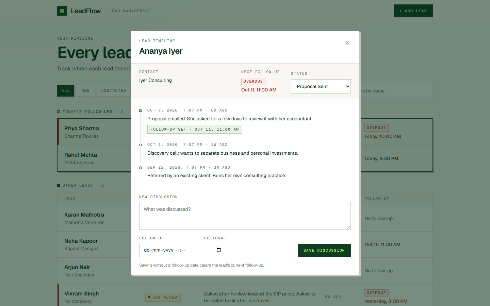
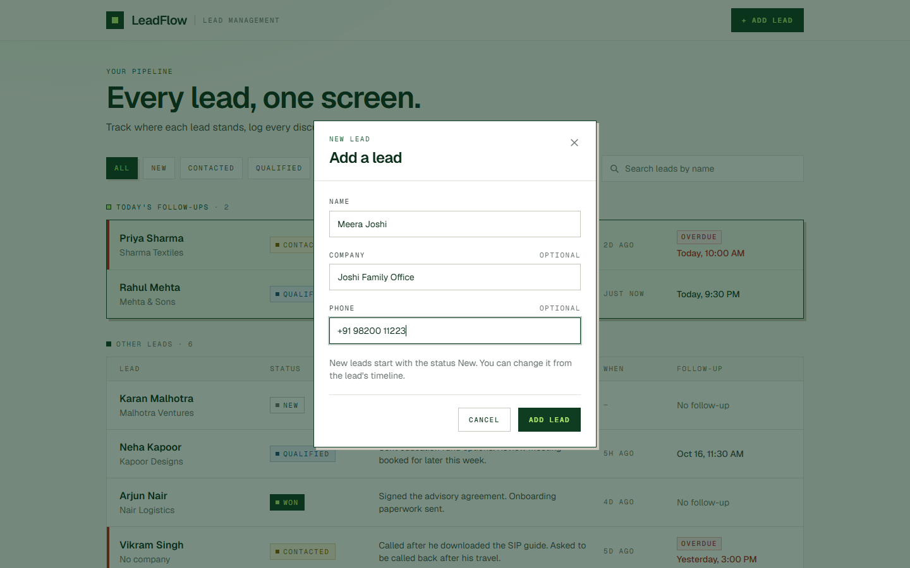
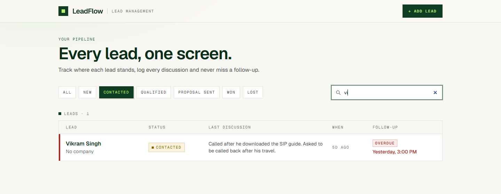
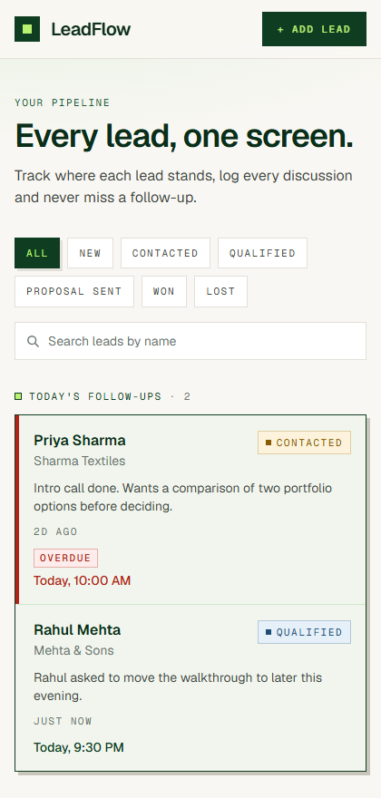

# LeadFlow

A single-screen lead management tool for a sales rep: track leads, log every discussion, and set follow-up reminders. Built as the take-home assessment for the fullstack intern role at Pravar AI.



## Features

Everything in the brief, plus the bonus items except Docker Compose.

| Requirement | Where to see it |
|---|---|
| Lead list with name, status badge, last note and time since last discussion | The main screen |
| Filter by status | The row of status buttons above the list |
| Today's follow-ups pinned at the top | The green "Today's follow-ups" section, soonest first |
| Timeline dialog with history in reverse chronological order | Click any lead |
| Add a discussion with an optional follow-up date and time | The form at the bottom of the dialog |
| The list updates immediately after saving | The row behind the dialog changes without a reload |
| Status can be updated from the dialog | The status dropdown in the dialog |
| Add a new lead (name required, status defaults to New) | The "Add lead" button in the header |
| **Bonus:** search leads by name | The search box above the list |
| **Bonus:** overdue follow-ups highlighted in red | Red bar, "Overdue" tag and red date on the row |
| **Bonus:** seed script with at least 5 leads and discussions | `python seed.py` loads 8 leads and 16 discussions |

Not included: login (optional in the brief) and Docker Compose.

## Screenshots

| Lead timeline | Add a lead |
|---|---|
|  |  |

| Status filter and search | Narrow screen |
|---|---|
|  |  |

## Tech stack

- **Frontend:** Next.js 16 (App Router), React 19, TypeScript, Tailwind CSS 4, TanStack Query
- **Backend:** FastAPI, SQLAlchemy 2, Alembic, Pydantic
- **Database:** PostgreSQL
- **Tests:** pytest (API), Vitest (date logic)

## Project structure

```
LeadFlow/
├── backend/
│   ├── app/
│   │   ├── main.py        app, CORS, router and error-handler registration
│   │   ├── config.py      settings read from .env
│   │   ├── database.py    engine and session
│   │   ├── errors.py      error types and the single error response shape
│   │   ├── models/        Lead and Discussion tables
│   │   ├── schemas/       request and response validation
│   │   ├── services/      database logic
│   │   └── routers/       HTTP endpoints
│   ├── alembic/           migrations
│   ├── tests/             API tests
│   └── seed.py            sample data
├── frontend/
│   └── src/
│       ├── app/           layout, page, providers, theme
│       ├── components/    list, rows, dialogs, forms
│       ├── hooks/         data fetching and small utilities
│       └── lib/           API client, types, date helpers
└── docs/screenshots/
```

## Prerequisites

- Python 3.11+
- Node.js 20+
- PostgreSQL 14+ running locally

## Setup

The commands below are for Windows PowerShell; the macOS/Linux equivalents are in the comments.

### 1. Database

Create an empty database:

```sql
CREATE DATABASE leadflow_db;
```

### 2. Backend

```powershell
cd backend
python -m venv venv
venv\Scripts\activate          # macOS/Linux: source venv/bin/activate
pip install -r requirements.txt
copy .env.example .env         # macOS/Linux: cp .env.example .env
```

Edit `backend/.env` with your PostgreSQL credentials, then create the tables, load the sample data and start the API:

```powershell
alembic upgrade head
python seed.py
uvicorn app.main:app --reload
```

The API runs at http://localhost:8000. Check http://localhost:8000/health to confirm the database connection; interactive docs are at http://localhost:8000/docs.

`python seed.py` adds 8 leads with discussions, including follow-ups that are due today, overdue and upcoming. Their dates are relative to the moment the script runs. It refuses to run if leads already exist; `python seed.py --reset` deletes all existing leads and discussions first.

### 3. Frontend

In a second terminal:

```powershell
cd frontend
npm install
copy .env.example .env.local   # macOS/Linux: cp .env.example .env.local
npm run dev
```

The app runs at http://localhost:3000.

## Environment variables

| File | Variable | Description | Example |
|---|---|---|---|
| `backend/.env` | `DB_HOST` | PostgreSQL host | `localhost` |
| `backend/.env` | `DB_PORT` | PostgreSQL port | `5432` |
| `backend/.env` | `DB_USER` | PostgreSQL user | `postgres` |
| `backend/.env` | `DB_PASSWORD` | PostgreSQL password | |
| `backend/.env` | `DB_NAME` | Database name | `leadflow_db` |
| `backend/.env` | `CORS_ORIGINS` | Comma-separated origins allowed to call the API | `http://localhost:3000` |
| `frontend/.env.local` | `NEXT_PUBLIC_API_URL` | Base URL of the API | `http://localhost:8000` |

Both folders have a `.env.example` listing these.

## API

| Method | Path | Description | Success | Errors |
|---|---|---|---|---|
| GET | `/health` | API and database check | 200 | 503 |
| GET | `/leads` | List leads; optional `status` and `search` query parameters | 200 | 422 |
| POST | `/leads` | Create a lead | 201 | 422 |
| GET | `/leads/{id}` | Get one lead | 200 | 404, 422 |
| PATCH | `/leads/{id}` | Update a lead's status | 200 | 404, 422 |
| GET | `/leads/{id}/discussions` | List a lead's discussions, newest first | 200 | 404, 422 |
| POST | `/leads/{id}/discussions` | Add a discussion, optionally with a follow-up date | 201 | 404, 422 |

Status values are `new`, `contacted`, `qualified`, `proposal_sent`, `won` and `lost`.

Every lead in a response carries `last_note` and `last_discussion_at`, taken from its most recent discussion. Follow-up dates must include a timezone offset, for example `2026-10-14T10:30:00+05:30`.

Every error uses the same shape:

```json
{
  "error": {
    "code": "validation_error",
    "message": "Request validation failed",
    "fields": [{ "field": "name", "message": "String should have at least 1 character" }]
  }
}
```

`fields` is only present on validation errors.

## Design decisions

- **"Today" and "overdue" are decided in the browser.** The API stores and returns absolute, timezone-aware timestamps, and the frontend compares them with the user's local clock. Pinning is therefore correct in any timezone, and a page left open keeps itself current with a clock that ticks every minute.
- **Pinned means due today; red means the time has passed.** Only follow-ups dated today are pinned, as the brief asks. A follow-up is shown in red as soon as its time has passed, so one from earlier today is both pinned and red, and one from a previous day is red in the main list.
- **A lead's follow-up mirrors its latest discussion.** Saving a discussion with a date sets the follow-up; saving one without a date clears it. Without the second half there would be no way to mark a follow-up as done, and a lead would stay overdue forever. The form states this next to the date field.
- **The last note is derived, not stored.** The list query joins each lead to its most recent discussion, so the note and "time ago" cannot drift out of sync with the timeline.
- **Filtering and search run on the server.** `status` and `search` are query parameters; the search box waits 300 ms after typing stops before calling the API.
- **Immediate updates come from cache invalidation.** Every save invalidates the lead queries, so the list and the open timeline refetch together and always show what the server has.
- **The form rejects a follow-up in the past,** since it would be overdue the moment it was saved. The API itself accepts one, which is how the seed script creates overdue samples.
- **Dialogs use the native `<dialog>` element,** which provides the focus trap, Escape to close and the backdrop without a UI library.
- **Layers on the backend:** routers handle HTTP, services hold the database logic, and all errors pass through one set of handlers.
- **Visual style:** the colours and typography take their cue from the Pravar AI website.

## Tests

Backend API tests (27):

```powershell
cd backend
venv\Scripts\activate
pytest
```

The tests run against the database configured in `backend/.env`. Each test runs inside a transaction that is rolled back, so no test data is left behind and existing data is untouched.

Frontend unit tests (12), covering the date logic behind "due today", "overdue" and "time ago":

```powershell
cd frontend
npm test
```

## Use of AI

This project was built with [Claude Code](https://claude.com/claude-code), Anthropic's AI coding assistant, and it did most of the implementation.

- **What the AI did:** analysed the brief and proposed the plan, then wrote the backend, the frontend, the tests, the seed script and this README, one step at a time. It also ran the tests and drove the app in a headless browser to check each flow, and took the screenshots above.
- **What I did:** chose the environment (local PostgreSQL, no Docker), approved the plan and directed each step, set the visual direction, ran the app, and made every commit.
- **Decisions the AI proposed:** the follow-up rule described under Design decisions was the AI's recommendation, which I accepted.
